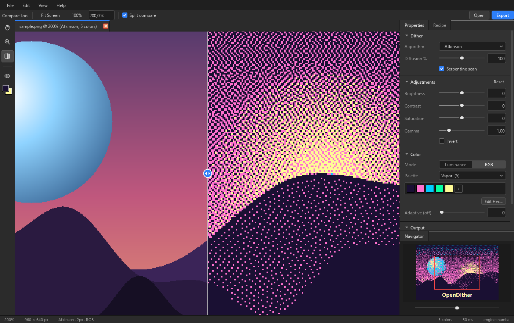

# OpenDither

**Free, open-source image dithering for everyone** — a desktop app, a web app, a drop-in website
component, a command-line tool and libraries for Python and JavaScript. All of them share one engine
spec, so a look you design in one works identically in the others.



## Features

- **21 algorithms**
  - Error diffusion: Floyd–Steinberg, False Floyd–Steinberg, Jarvis–Judice–Ninke, Stucki, Burkes, Sierra, Sierra Two-Row, Sierra Lite, Atkinson
  - Ordered: Bayer 2×2 to 16×16, clustered dot, halftone, horizontal, vertical and diagonal lines
  - Noise: seeded random, interleaved gradient noise
  - Threshold (no dithering)
- **Palettes**: 16 presets (1-bit, grayscale, Pocket Green, CGA, EGA, Vapor, Riso…), custom palettes
  (paste hex codes), or **adaptive** palettes extracted from the image (median cut)
- **Two color modes**: *Luminance* maps brightness onto the palette (duotones, tritones); *RGB* matches full colors
- **Adjustments**: brightness, contrast, saturation, gamma, invert
- **Pixel size** for chunky retro looks, plus nearest-neighbour **export upscaling**
- **Recipes**: every setting as a small JSON file, portable between all OpenDither apps
- Pro-app interface: dark theme, tools bar, Properties panel, Navigator, split before/after compare, zoom and pan, scrubby sliders

## Pick your flavour

| | What | Where |
|---|---|---|
| 🖥️ | **Desktop app** (Windows, macOS, Linux) | [`python/`](python) |
| 🌐 | **Web app** — runs in the browser, nothing is uploaded | [`web/`](web) |
| 🧩 | **Website add-on** — `<open-dither>` element and `OpenDither.auto()` | [`js/`](js) |
| ⌨️ | **CLI** — batch-process folders | [`python/`](python) |
| 📚 | **Libraries** — Python (`numpy`) and JavaScript (zero dependencies) | [`python/`](python), [`js/`](js) |

### Desktop app and CLI (Python 3.10+)

```bash
cd python
pip install ".[gui]"          # PySide6 + numba for fast previews
opendither-gui                # or: python -m opendither
```

```bash
opendither photo.jpg -a atkinson -p newsprint --scale 2
opendither photos/ -o out/ --recipe my-look.json --export-scale 4
opendither --list             # all algorithms and palettes
```

```python
from PIL import Image
from opendither import dither

result = dither(Image.open("photo.jpg"), algorithm="bayer-8", colorMode="rgb", palette="vapor", scale=3)
result.save("photo-dithered.png")
```

### Web app

It's plain static files with no build step. Serve the repo and visit `/web/`:

```bash
python -m http.server 8000      # then open http://localhost:8000/web/
```

With GitHub Pages enabled on this repo, the root `index.html` redirects to the web app.

### On your website

Copy `js/src/opendither.js` and `js/src/opendither-element.js` next to your page:

```html
<script src="opendither.js"></script>
<script src="opendither-element.js"></script>

<!-- a custom element -->
<open-dither src="photo.jpg" algorithm="atkinson" palette="#1b1b1b,#f2ecd9" scale="2" reveal="hover"></open-dither>

<!-- or upgrade ordinary images -->

<script>OpenDither.auto()</script>
```

The web app's **Embed** tab writes this code for your current settings. See [`js/README.md`](js/README.md)
for every attribute and the JavaScript API.

## Recipes

A recipe is the full set of settings as JSON:

```json
{
  "algorithm": "atkinson",
  "strength": 1,
  "serpentine": true,
  "seed": 1,
  "scale": 2,
  "brightness": 0,
  "contrast": 15,
  "saturation": 0,
  "gamma": 1,
  "invert": false,
  "colorMode": "luminance",
  "palette": "newsprint",
  "adaptive": 0
}
```

Save one from any app (*File ▸ Save Recipe*), then load it in another app, pass it to the CLI with
`--recipe`, or to the web component with `settings='{…}'`.

## One spec, many languages

[`spec/ALGORITHMS.md`](spec/ALGORITHMS.md) defines every step of the pipeline precisely, and
[`spec/test-vectors.json`](spec/test-vectors.json) holds hashes of reference outputs. The Python and
JavaScript implementations both reproduce every vector bit for bit, and CI checks it on every push.

Want OpenDither in Rust, Go, C#, Swift, a Photoshop/GIMP plugin, or a Blender add-on? Port the spec,
make the vectors pass, and open a pull request. See [CONTRIBUTING.md](CONTRIBUTING.md).

## Repository layout

```
spec/       algorithm spec, palettes, cross-language test vectors
js/         JavaScript library + <open-dither> web component (zero dependencies)
web/        browser app (static files, no build step)
python/     Python library, CLI and PySide6 desktop app
docs/       screenshots
```

## License

[MIT](LICENSE). Use it in anything, commercial or not.
